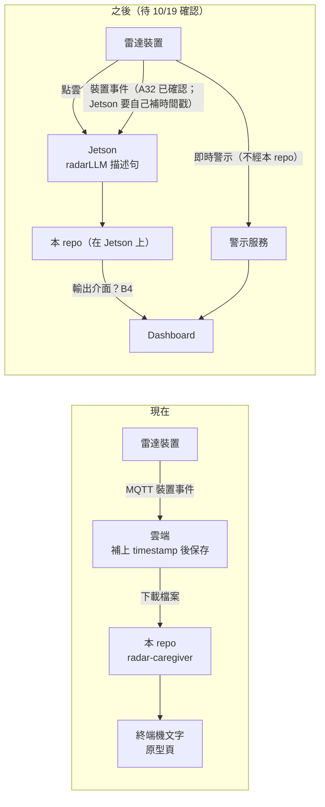

# 內部演示流程（2026-10-16）

在對甲方 Demo（`11_Demo規劃.md`、`12_Demo預演.md`）之前，先對團隊內部演示一次：讓雷達、Dashboard、公司研發看到本 repo 現在做到哪裡、資料從哪來、輸出要交到哪，並把下週一（2026-10-19）確認 Dashboard 架構要談的題目先攤開。週一會議的主要目標是讓研發人員知道還缺哪些資訊，整理在 `14_週一資訊需求_2026-10-19.md`；本文件是那場會議的開場。

**對象**：雷達負責人、Dashboard 負責人、公司研發。**時間**：約 25 分鐘（演示 15 分鐘，其中說明 Gap 5 分鐘；討論 10 分鐘）。

## 開場一定要說的三件事

1. **現在用的是「現在的資料」**：雲端保存的裝置事件格式 `{timestamp, topic, resolution, payload}`（會議清單 A2），payload 照 2026-10-12 的 MQTT 規格。畫面上的一個上午與兩週趨勢是依這個格式產生的**模擬資料**（`data/samples_demo/`）；已取得的 5 天實測資料（A10，78,338 筆）只在本機用來對照格式，不放進 repo。
2. **之後改用 Jetson 的輸出**：正式部署時，本 repo 跑在 Jetson 上，讀 Jetson 收到的資料，不再從雲端下載檔案。哪些地方要跟著改，見下方「從現在的資料換到 Jetson 輸出」。
3. **Dashboard 架構下週一（10/19）確認**：今天的原型頁只是示意本 repo 產生的內容，**不是 Dashboard 的畫面**，也不是即時警示。輸出怎麼交給 Dashboard、由誰呈現，週一確認後再定。

## 資料流：現在與之後



## 演示流程（約 15 分鐘）

| # | 演示 | 怎麼做 | 要講的重點 | 時間 |
|---|---|---|---|---|
| 1 | 開場三件事 | 口頭，搭配上面的資料流圖 | 現在的資料、之後的 Jetson 輸出、週一確認 Dashboard | 1.5 分 |
| 2 | 原型頁重播 | 開 `demo/prototype.html#replay`，依 `12_Demo預演.md` 的講稿精簡版走 A～D 與斷線 | 三項機制、回覆沒事不算誤報、斷線寫「無法判斷」；**卡片是本 repo 產生的處置提示，不是即時警示**（即時警示走警示服務，KPI 3 < 10 秒不經過本 repo） | 4 分 |
| 3 | 同一份資料，終端機輸出 | `radar-caregiver data/samples_demo/bathroom_morning.jsonl --place "1 號廁所"` | 畫面上的句子都是這支程式產生的；三段（事件摘要、處置提示、照護紀錄草稿） | 1 分 |
| 4 | 輸出檢查會擋 | `radar-caregiver data/samples_demo/bathroom_morning.jsonl --place "治療室"` | 用到醫療用詞就整段不輸出（決策單 D-3 待定）；接上在地模型後也走同一個檢查 | 0.5 分 |
| 5 | 兩週使用趨勢 | 原型頁捲到最下面，或 `radar-caregiver outputs/bathroom_two_weeks.jsonl --place "1 號廁所" --trend`（先跑 `python data/samples_demo/generate.py --two-weeks`） | 場域統計、不推測是誰；在線不足的日子不列入 | 1 分 |
| 6 | 10/19 實測資料的準備 | `radar-field-data inspect data/samples_demo/bathroom_morning.jsonl` | 實機操演的腳本（`12_Demo預演.md`「10/19 實機操演」）、遮罩、時區檢查；請雷達負責人先回答操演前的 5 個問題 | 1.5 分 |
| 7 | 用畫面說明 Gap | 開 `demo/prototype.html#gaps`，照下方「用畫面說明 Gap」由上往下講 | 現在、目標、卡在哪一題 | 5 分 |
| 8 | 帶到討論 | 打開本文件「週一要確認的題目」 | 每題都影響本 repo 下一步做什麼 | 0.5 分 |

內部演示可以打開決策單（`10_會議決策單_2026-10-16.md`）與 PR，對甲方 Demo 時不行。

## 用畫面說明 Gap（演示第 2 步之後，約 5 分鐘）

重播完一次後，改開 `demo/prototype.html#gaps`（線上預覽網址也一樣加 `#gaps`）。頁首會多一張「Gap 一覽」，畫面上相關的區塊旁邊出現橘色編號，點編號會跳到表中對應的那一列。**只在內部演示用**；對甲方 Demo 用 `#replay`，不會出現編號與一覽表。

建議照畫面由上往下講，每一項都講三句：現在怎麼做、目標是什麼、卡在哪一題。

| # | 指著畫面的哪裡 | 一句話說明 Gap | 卡在哪 |
|---|---|---|---|
| 1 | 頂端橫幅 | 現在是模擬資料（雲端裝置事件格式），之後要換成實測資料、正式部署讀 Jetson（Jetson 收得到裝置事件，A32 已確認） | A10 |
| 2 | 時鐘與時間軸 | 時間是雲端「收到」的時間，不是事件「發生」的時間，所以通報時間（KPI 3）量不出來；時區也還沒確認 | A4、A27 |
| 3 | 處置提示卡片 | 這是事後整理出來的，不是即時通知；即時警示由警示服務發，不經本 repo | 10/19 Dashboard 題 3 |
| 4 | 跌倒警報那張卡 | 計畫書例句要寫「姿態持續 30 秒」，裝置事件沒有持續時間，寫不出來 | A6 |
| 5 | 所有句子 | 範本產生；改寫層與檢查已做好，還沒接 Jetson 上的模型 | B1、F2 |
| 6 | 照護紀錄草稿 | 格式是自訂的、也沒有保存；要達到「撰寫時間降低一半」與文字指標，需要機構的紀錄樣本 | F13、F12、Dashboard 題 4 |
| 7 | 事件摘要的次數 | 次數可不可信，要看去重（沒有序號）與標註資料；準確率、漏報率目前都沒有數字 | A11、A26、A10 |
| 8 | 兩週使用趨勢 | 場域統計、模擬兩週；要做個人基線，需要長者代號與超過 7 天的歷史 | A15、E8、Dashboard 題 8 |
| 9 | 標題（整個頁面） | 這是原型頁，不是 Dashboard；輸出怎麼交、什麼格式，週一確認 | B4、Dashboard 題 1、2 |
| — | 畫面上沒有 | 體適能等級：判定可用，但量測值要人工輸入，知識圖譜尚未核准 | E7、E5 |

畫面上的 Gap 一覽寫在 `demo/template.html`；這張表或會議清單的題號有變動時，兩邊要一起改。

## 從現在的資料換到 Jetson 輸出

| 項目 | 現在（雲端下載的裝置事件） | 之後（Jetson） | 本 repo 要改什麼 | 待確認 |
|---|---|---|---|---|
| 資料內容 | 裝置事件（presence、fall、resolved…） | 同樣的裝置事件：Jetson 訂閱的 topic 包含所有裝置事件（A32，2026-10-14 已確認）。另外還有點雲經 radarLLM 轉出的描述句 | 沿用 `device_events.py`；描述句要不要也用、怎麼用另外決定（描述句是語言模型的輸出，不能直接當量測值） | A21、A22 |
| 怎麼拿到 | 下載檔案，一次處理一段時間 | Jetson 訂閱 MQTT，資料持續進來 | 加一層「接收 → 暫存 → 定時整理」；斷線補傳要處理 | B 類、D3 |
| 時間戳 | 雲端收到時補上，時區待確認 | 誰補、用哪個時鐘？ | 時間戳由 Jetson 補上時，要定好格式與時區，`TIMESTAMP_FORMAT` 可能要改 | A4、A27 |
| 裝置識別 | topic 裡的 MAC | 同一個 topic | 營運資料照常保存 MAC；給第三方或研究用時換成代號 | A5、F10 |
| 斷線判定 | 超過 30 秒沒資料（BW20 keepalive） | Jetson 自己和裝置之間的連線狀態 | 30 秒門檻沿用或改由 Jetson 提供在線狀態 | D3 |
| 去重 | 只能比「完全一樣」 | 同左，等序號 | 有序號後改用序號去重 | A11 |
| 輸出 | 印在終端機、原型頁 | 交給 Dashboard | 依週一的結論做輸出介面 | B4 |

不受影響的部分：處置提示與照護紀錄草稿的用語、輸出檢查、改寫層與讀者權限，只看整理好的事件，不在乎資料從哪來。

## 週一（10/19）確認 Dashboard 架構要談的題目

| # | 題目 | 為什麼本 repo 要知道 | 對應 |
|---|---|---|---|
| 1 | 本 repo 的輸出怎麼交給 Dashboard：API、寫檔、資料庫，還是 MQTT？誰呼叫誰？ | 決定要做哪一種輸出介面 | B4 |
| 2 | 輸出的格式：純文字三段，還是結構化資料？ | 原型頁用的資料已經是結構化的（每個事件有時間、等級、標題、處置提示、照護紀錄），可以當草案（見下方） | B4 |
| 3 | 即時警示誰發？處置提示要不要跟即時警示合在同一則通知？ | 即時警示不經本 repo（KPI 3 < 10 秒）；本 repo 的處置提示若也要即時送出，延遲與失敗處理要重新設計 | KPI 3、`02_目標架構.md` 原則 1 |
| 4 | 照護紀錄草稿寫回哪裡？照護人員在哪裡編輯、確認？ | 決定紀錄要不要保存、保存在哪一邊；也關係到查核點 B4 由誰交付 | F12、F13 |
| 5 | 讀者權限在哪一層做：本 repo 只產生允許的內容，還是 Dashboard 也要控管？ | 本 repo 已有權限表（`audience.py`），要避免兩邊規則不一致 | F4 |
| 6 | 長者代號與姓名的對照表由誰保管？本 repo 能不能只拿代號？ | 決定本 repo 要不要負起保護個人資料的責任 | A15 |
| 7 | 現場回饋（誤報／屬實）從 Dashboard 怎麼回到本 repo？ | 第 2 步「現場回饋」要接在這裡 | `02_目標架構.md` 建議順序 |
| 8 | 週報與使用趨勢的分工：週報已交給 Dashboard，本 repo 的使用趨勢（`--trend`）要不要也改由 Dashboard 算？ | 避免同一個數字兩邊各算一次而不一致（`07_週報交接_Dashboard.md`「同一個數字不要算兩次」） | C1～C3 |

### 輸出格式草案（給第 2 題參考，尚未實作成介面）

原型頁內嵌的資料（`demo/build.py` 的 `demo_data()`）已經是下面的形狀，數字與句子都來自 `radar-caregiver` 並通過輸出檢查：

```json
{
  "place": "1 號廁所",
  "from": "2026-10-14 08:00:00",
  "to": "2026-10-14 11:59:55",
  "summary": "1 號廁所 10/14：有人使用 5 次，……",
  "events": [
    {"at": "2026-10-14 08:32:10", "label": "08:32", "level": "urgent", "title": "跌倒警報",
     "prompt": "請立即到場確認。", "record": "08:32 1 號廁所雷達偵測到疑似跌倒，語音詢問 10 秒未獲回應。"}
  ]
}
```

`level` 是 `urgent`（立即到場）、`check`（前往查看）、`resolved`（警報解除）、`device`（裝置斷線）四種。**2026-10-19**：已做成 `radar-caregiver --json`，欄位見 `16_Dashboard對接說明.md`。正式介面還要加上：規則與範本的版本、Profile、產生時間、事件編號（`02_目標架構.md` 原則 3「每一筆都追得回來」）。週一確認後再定。

## 演示後

- 週一的結論記進 `05_會議待詢問清單.md`（題號見 `14_週一資訊需求_2026-10-19.md`），並更新本文件的資料流圖。
- 依結論排下一步：輸出介面（第 1、2 題）、Jetson 上接收 MQTT 並補時間戳、即時路徑的分工（第 3 題）。
