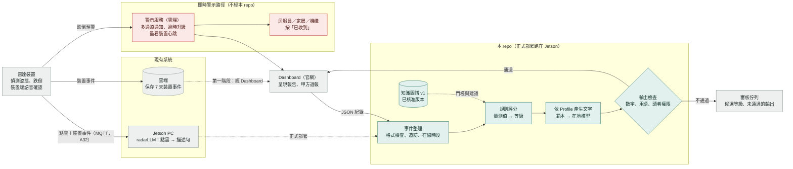
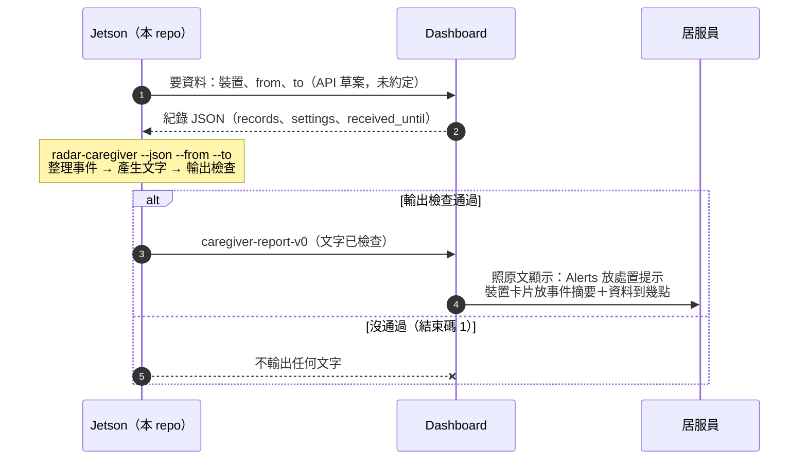
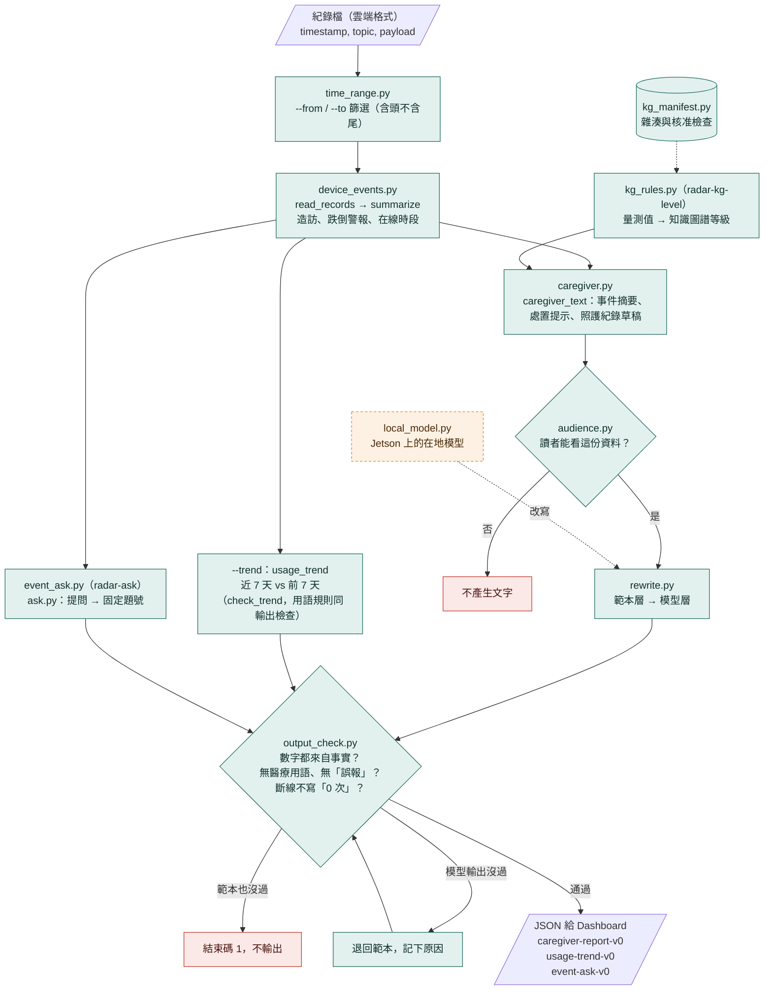

# 流程圖（2026-10-23）

把 `02_目標架構.md`、`16_Dashboard對接說明.md` 與 `src/radar_agent/` 現在的狀態畫成三張圖：全系統的兩條路、第一階段 Jetson 與 Dashboard 的交換、本 repo 內部從紀錄到文字的步驟。這裡只是整理，不是新的決定；內容有出入時以原文件為準，改了流程要同步更新這份。

圖例：綠色是本 repo，灰色是現有系統或其他團隊，紅色是即時警示路徑或停止輸出，虛線是還沒定案或還沒接上。

## 1. 全系統：兩條路分開

跌倒警示走秒級的即時路徑，不經過知識圖譜、LLM，也不經過本 repo（`adr/0006`）。分析建議路徑的等級由規則與知識圖譜決定，在地模型只改寫說法（`02_目標架構.md` 原則 2）。

- 主要輸入是裝置事件；radarLLM 描述句只當補充，不拿來計數或判定（`adr/0001`）。
- 本 repo 不接收音訊（`adr/0005`），不讀雷達點雲本身。
- 甲方週報（跌倒次數、活動量）由 Dashboard 自己統計（`adr/0004`）。

## 2. 第一階段：Jetson 與 Dashboard 的交換

2026-10-23 確定：Demo 期間由 Dashboard 提供 JSON，暫時不從 Jetson 直接收 MQTT。先用三天內的資料，只做居服員的內容（`16_Dashboard對接說明.md`「第一階段的流程」）。下圖的請求與回應欄位是 API 草案，還沒和 Dashboard 約定。

待確認：

- Jetson 怎麼向 Dashboard 要資料：網址、認證、參數、更新頻率（`16_Dashboard對接說明.md` 清單 4-1）。
- 單向門，要人決定：`counts` 要能表示「無法判斷」，回傳要附資料到哪裡為止。
- 警報沒開時報告怎麼寫，要先拿到 `settings`（A52）。
- Radar60FL 的格式目前讀不懂，欄位意思確認前不寫轉換程式（A45–A50）。
- 「警報已解除」要不要列在 Alerts，待和 Dashboard 負責人確認。

## 3. 本 repo 內部：從紀錄到文字

三個命令列入口共用同一段事件整理與輸出檢查。文字一律先由範本產生；接上在地模型後，模型的輸出也要過同一個檢查，沒過就退回範本。

- 在地模型還沒接上真的型號（`06_Jetson硬體評估.md`），目前輸出都來自範本層。
- Demo 廁所沒有個人 ID，只出場域層級的報告；知識圖譜等級部分以人工輸入的量測值示範（換算規則卡在 E7，`09_換算規則草稿.md`）。
- 每段文字記下走哪一層（範本或哪一版模型），以及知識圖譜版本。
